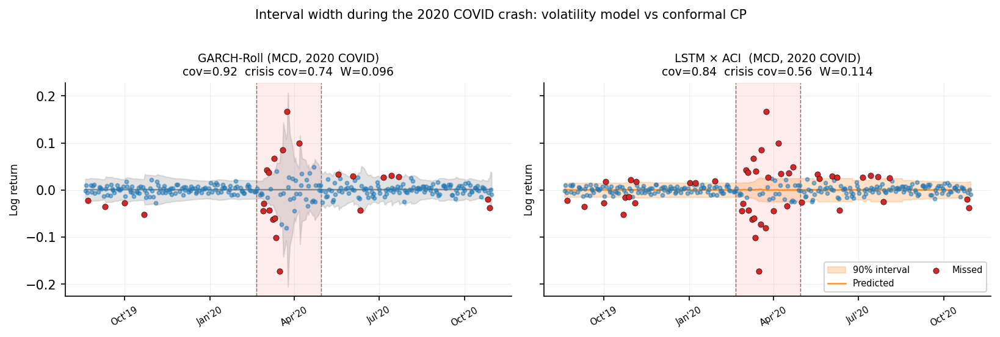

# conformalQuant

**Can conformal prediction beat classical volatility models at forecasting
daily return intervals when markets crash?**

An empirical study on US equities through the 2008 Lehman collapse, the 2020
COVID crash and the 2022 rate-hike sell-off. We pit split, adaptive (ACI) and
aggregated adaptive (AgACI) conformal prediction, wrapped around linear, LSTM
and Transformer forecasters, against properly fitted rolling GARCH and
Filtered Historical Simulation.

**Short answer: no, and the reason is structural.** Full write-up in
[`report/report.pdf`](report/report.pdf).



*MCD through the 2020 crash. Rolling GARCH (left) widens its 90% interval the
day volatility spikes; LSTM × ACI (right) stays narrow and racks up misses
(red) inside the crisis window (shaded).*

## Key findings

- **Volatility models win.** Rolling GARCH(1,1)-t scores a Winkler of
  **0.199** and FHS 0.242. The best conformal method (LSTM × ACI) scores
  0.305, 53% worse, and the gap holds in all three crises.
- **Why: conformal scores look backward.** GARCH recomputes
  σ²ₜ₊₁ = ω + α·rₜ² + β·σ²ₜ every day, so one large return widens tomorrow's
  interval. A conformal interval is a quantile of stored calibration
  residuals and can only move as new residuals accumulate. GARCH widens
  1.42× during crises; split CP doesn't widen at all (1.00×) and ACI/AgACI
  only 1.15–1.20×.
- **TCP's reported parity with GARCH is partly a baseline artefact.**
  Temporal Conformal Prediction was benchmarked against a GARCH with
  hard-coded parameters that is never refit. Against a rolling, MLE-fitted
  GARCH, TCP (0.281) beats every other conformal method but still loses to
  both volatility baselines.
- **Model complexity doesn't matter inside a conformal wrapper.** LinearAR,
  LSTM and Transformer under ACI land within 2% of each other.
- **Online adaptation is what matters.** A Quantile Regression Forest
  updated online, with no conformal layer at all (0.309), matches
  LSTM × ACI at a fraction of the complexity.

| Model | Wrapper | Coverage | Crisis cov. | Winkler ↓ | Crisis width expansion |
|---|---|---|---|---|---|
| GARCH-Roll | native | 0.949 | 0.895 | **0.199** | 1.42× |
| FHS | native | 0.915 | 0.857 | 0.242 | 1.56× |
| TCP (daily refit) | rolling CP | 0.897 | 0.813 | 0.281 | 1.36× |
| LSTM | ACI | 0.820 | 0.668 | 0.305 | 1.18× |
| LinearAR | ACI | 0.821 | 0.668 | 0.307 | 1.19× |
| QRF | online | 0.801 | 0.671 | 0.309 | 1.35× |
| Transformer | ACI | 0.819 | 0.664 | 0.311 | 1.20× |
| LSTM | split | 0.694 | 0.462 | 0.399 | 1.00× |

Target coverage is 0.90. GARCH and FHS are averaged over 7 of 9 cells (AIG
and GNW in 2008 are dropped because MLE converged to a near-unit-root
solution on the pre-crisis window). Full table and per-regime breakdown are
in the report.

## Setup

| Crisis | Tickers | Window |
|---|---|---|
| 2008 Lehman | AIG, GNW, MGM | 2008-09-15 → 2009-03-31 |
| 2020 COVID | MCD, MGM, AZO | 2020-02-20 → 2020-04-30 |
| 2022 rate hikes | SNAP, NFLX, META | 2022-01-03 → 2022-12-31 |

- **Data:** daily log returns from `yfinance`.
- **Splits:** every (ticker, crisis) cell gets a fresh fit with 4 years of
  training, 6 months of calibration, then a day-by-day walk-forward test
  from 6 months before the crisis starts to 6 months after it ends.
- **Fairness:** every adaptive method refits on the same 21-trading-day
  cadence, and all intervals target 90% coverage.
- **Metrics:** Winkler score (primary: penalises width plus 20× any miss at
  α = 0.10), marginal and crisis-window coverage, coverage gap between
  high- and low-volatility days, crisis width expansion, and days to recover
  coverage after onset.

| Category | Methods |
|---|---|
| Baselines | Rolling GARCH(1,1) with Student-t (`arch`), Filtered Historical Simulation |
| Simple native | Online Quantile Regression Forest, online histogram binning |
| Simple CP | 5-lag linear AR × {split, ACI, AgACI} |
| Complex CP | LSTM(50), Transformer encoder (d=32, 4 heads) × {split, ACI, AgACI} |
| TCP | Paper-faithful Temporal Conformal Prediction (quantile GBMs + rolling calibration) |

## Running it

```bash
python3 -m venv .venv && source .venv/bin/activate
pip install -r requirements.txt

python scripts/run_grid.py                  # full grid, ~10 min on CPU
python scripts/run_grid.py --only baselines # or simple_native / simple_cp / complex_cp
python scripts/build_artifacts.py           # metrics table + paper figures
```

Interval CSVs for every cell are already committed in `results/` (with the
aggregate in `results/metrics_long.csv`), so the notebooks and figures render
without re-running the grid. `implementation.md` has the full technical
reference: split geometry, timings, output schema and a decision log.

## Repository layout

```
src/
  conformal/   GARCH and FHS baselines, split / ACI / AgACI / TCP wrappers,
               native-interval methods (QRF, histogram binning)
  models/      Point forecasters: linear AR, LSTM, Transformer encoder
  metrics/     Coverage, Winkler, width and adaptation metrics (spec in Metrics.md)
  data/        yfinance loader and lag-window transforms
  analysis/    One notebook folder per method category + results.ipynb
scripts/       run_grid.py (end-to-end runner), build_artifacts.py
results/       Per-cell interval CSVs and aggregate metrics
report/        LaTeX source, figures and compiled PDF
```

## References

- Gibbs & Candès (2021), [Adaptive Conformal Inference Under Distribution Shift](https://arxiv.org/abs/2106.00170)
- Zaffran et al. (2022), [Adaptive Conformal Predictions for Time Series](https://arxiv.org/abs/2202.07282)
- Aich, Aich & Jain (2026), [Temporal Conformal Prediction (TCP)](https://arxiv.org/abs/2507.05470)
- Meinshausen (2006), Quantile Regression Forests, *JMLR*
- Barone-Adesi & Giannopoulos (2001), Non-parametric VaR Techniques: Myths and Realities, *Economic Notes*
- Fantazzini (2024), Adaptive Conformal Inference for Computing Market Risk Measures, *JRFM*
- Sheppard, [`arch`](https://github.com/bashtage/arch): ARCH models in Python

## Authors

Saurav Banna, Aditya Goel, Jaskeerat Singh Sarin
